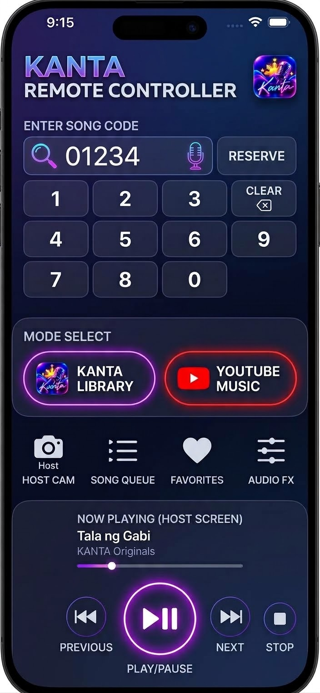

# Companion Remote — built-in apps and browser access

**Owner-approved requirement — October 18, 2026. PR #51 candidate implementation; hosted native/browser acceptance and physical-device review pending. Not released.**

The owner moved the built-in and browser remote implementation into PR #51. PR #53 preserves the original reference and planning provenance. Library/Host restoration stays isolated in PR #52. See [implementation and trust boundary](COMPANION_BROWSER_CHECKPOINT.md).

## Approved experience and reference

The same KANTA installation offers **Host** and **Companion Remote** modes on both iOS and Android. Selecting Companion Remote presents the supplied remote design after connection/pairing, rather than requiring another remote application. A guest without KANTA can also enter the host's displayed LAN IP/address (and port when needed) in a browser and pair. Native and browser clients observe and command the same host session; they never own another karaoke queue or play the host's audio locally.

Reference: owner attachment `IMG_0563.jpeg`; SHA-256 `6528e70c88cc70aa3ea9331c6980e254e66d376d96e101d3906d729a19fc0188`. Preserve its original bytes as design evidence. It is a reference, not an approved replacement app icon or a source of redistributable third-party artwork. Use the accepted KANTA assets and reviewed provider branding when implementing.

## Visual and functional specification

| Area | Required behavior |
| --- | --- |
| Identity and layout | Midnight navy background, purple/cyan neon accents, KANTA Remote Controller header, rounded cards and large accessible controls; responsive phone/tablet, portrait/landscape layouts |
| Song entry | Editable song code plus title/artist search, explicit Reserve, Clear/backspace and optional user-triggered voice search; render search results before reserving |
| Numeric pad | Preserve the reference's prominent pad; normalize to a conventional 1–9 grid plus 0/Clear/backspace, with every digit available exactly once |
| Mode selector | KANTA Library and YouTube context, visibly identifying which host source receives commands; switching mode does not start playback, merge engines or consume reservations |
| Shortcuts | Host Cam, Song Queue, Favorites and Audio FX, with host-authorized capability checks and clear unavailable states |
| Now playing | Host song/artist/source and current transport state; updates come from the host, with connected/reconnecting/disconnected feedback |
| Transport | Reference's remote Play/Pause, Next, Stop and Previous; progress/seek only when supported and authorized by the selected host source |
| Pairing | Host address entry and short-lived pairing flow; host shows its full connection address and pairing instructions, with optional QR convenience |
| Session control | Host can view and revoke guests, expire pairing/sessions and disable remote hosting; leaving remote mode disconnects cleanly |

Previous and progress/seek are scoped to this **remote design**. They do not change the existing no-Previous/no-progress-bar rule on the main/fullscreen karaoke stage. Unsupported transport commands must not be presented as working controls.

The YouTube mode remains bound to the official visible host player, its separate transport and supported capabilities. It does not imply a YouTube Music catalog/API integration, ad suppression, extraction, downloads, audio-only playback or automatic YouTube scoring. Do not forward online commands to the MIDI/KAR decoder.

## Platform and host ownership

- iOS Companion Remote and Android Companion Remote are built into their respective native apps, retaining independent source, dependencies and build/release boundaries.
- Both iOS and Android must support the planned host experience and host-address browser entry. Existing Android KCP1 hosting and iOS-to-Android client support are partial foundations, not proof of this new UI or browser access.
- A browser-compatible authenticated command/snapshot adapter is required. Browsers cannot use the existing native raw-TCP client directly. Reuse validated command contracts and host authorization/state ownership, not an independent browser queue.
- The host serves the remote page/assets locally after explicitly enabling companion hosting. The public website is not a media catalog, playback relay or a prerequisite for local remote control.
- LocalKaraokeController remains the iOS local FIFO authority; SessionController remains the Android authority. All adapters validate and route typed commands to the appropriate existing host/source owner.
- Version commands/capabilities before extending Stop, Previous, seek, Favorites, camera or FX beyond the currently implemented native command set. Unknown/unsupported actions fail explicitly.
- Preserve the original source files and private media. Guests receive only bounded metadata/snapshots, never arbitrary file access, signing materials or complete catalog dumps.

## Pairing, permissions and lifecycle requirements

1. Explicit host opt-in on the same LAN/Wi-Fi; entering an IP address alone grants no access. Do not expose hosting through port forwarding or public relay as part of this scope.
2. Define a browser-compatible authenticated encrypted transport and trust/bootstrap design before implementation. Resolve private-IP certificate, HTTPS/WSS, mixed-content and browser secure-context constraints; a plaintext PIN must not be called encrypted security. Guest setup must not depend on the owner's development workstation.
3. Authenticate before revealing host library/session details or accepting commands. Bound pairing attempts, use short-lived pairing proof and scoped per-client sessions, and support timeout/revocation and host foreground-loss cleanup.
4. Validate origin/host and request framing, lengths, capabilities and rates. Reject forged cross-site requests, replayed/expired commands and unsafe addresses; do not log pairing proofs or session secrets.
5. Retry suppression applies to the same command identity. Intentional repeat reservations retain distinct reservation identities. Reconnect must reconcile ambiguous results instead of blindly resending Reserve.
6. Host Cam requests require explicit host permission/consent. This shortcut does not authorize camera recording or streaming a live feed to guests. Browser microphone/voice support is opt-in and capability-gated, with ordinary text/keypad input always available.
7. Audio FX only exposes host-approved source-supported settings. A guest cannot silently enable host microphone capture, monitoring or camera. Unsupported YouTube pitch/FX remain unavailable.
8. Disconnecting a guest must not stop the host song or corrupt its queue. Revocation prevents further commands immediately. No hidden/background online media is introduced.

## Implementation tasks

- [ ] Audit the existing native pairing/command owners, version/capability contracts and iOS host gap.
- [ ] Design and review secure native/browser pairing, trust bootstrap, guest privileges and revocation.
- [ ] Add explicit Host / Companion Remote role navigation to both native apps without starting sensors, playback or hosting implicitly.
- [ ] Implement the supplied companion screen in iOS and Android, with corrected keypad geometry and accessible responsive layouts.
- [ ] Implement local host-served browser UI and authenticated browser command/snapshot adapter on both host platforms.
- [ ] Wire bounded song search/code lookup, Reserve/Cancel, host queue, Favorites and now-playing projections.
- [ ] Add source-aware transport and YouTube context only after the relevant host capability is implemented and tested.
- [ ] Add permission/capability-gated Host Cam and Audio FX actions.
- [ ] Cover wrong/expired pairing, unauthenticated requests, guest revocation, stale replies, reconnect ambiguity, command retry identities and duplicate intentional reservations.
- [ ] Verify iOS → iOS, iOS → Android, Android → iOS and Android → Android native control, plus supported mobile browsers against each host platform.
- [ ] Validate device rotation, narrow screens, large text, keyboard/voice fallback, simultaneous guests, host backgrounding and continued host playback after disconnect.
- [ ] Update architecture, privacy/legal, help, parity matrix and verified release evidence before public feature claims.

## Acceptance boundary

The original PR #53 contained documentation/reference only. PR #51 now contains a candidate HTTPS host on each native platform and the locally served remote inside each app or a browser. Search, reservations, cancellation, Play/Pause/Next/Stop are implemented. YouTube transport, Previous/seek, Favorites, camera and FX remain explicitly unavailable through this adapter. Hosted build/browser/runtime, four native host-client combinations, real mobile browser trust setup and independent security/device review remain separate acceptance gates. Existing KCP1 and legacy entry points are retained.
